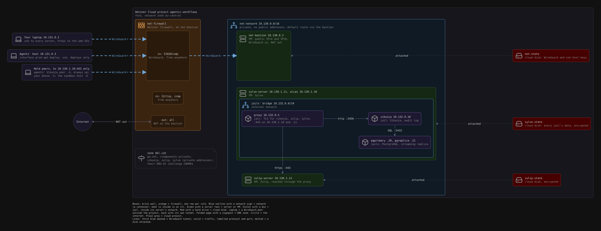

# Architecture

How production's components fit together, and why the platform has this shape. Each component's own what, why and how is in its README, under Infrastructure, and the seat that maintains it is in [COMPONENTS.md](../../imported/infra/COMPONENTS.md). The rules every component applies are in [CONSTANTS.md](../../imported/infra/CONSTANTS.md), section "Production". This page states them only to explain them.

## What

Production is one Hetzner Cloud project, `agentic-workflows`, in Falkenstein (`fsn1`). Its parts are **components**, and each component owns its cloud resources, whichever agent builds it:

| Component | What it is |
|---|---|
| `net` | The private network 10.130.0.0/16, the bastion `net-bastion` (the network's only way in and out), the firewall and the zone `dkl.cat`. |
| `sylve` | `sylve-server`, 10.130.1.11, running Sylve, which manages jails. Its jails include the reverse proxy, which serves every web UI over TLS. |
| `vikunja` | The board: Vikunja and its PostgreSQL primary and replica, in jails on `sylve-server`, at `https://vikunja.dkl.cat/`. |
| `zulip` | The messenger, the phone's way to the seats: `zulip-server`, 10.130.1.12, at `https://zulip.dkl.cat/`. |
| `playbook` | This site, served locally. |

How a request travels through it, and how a certificate is renewed: [Request journeys](request-journeys.md).

Dashed lines run inside WireGuard. Every client is a WireGuard peer of the bastion:

- **Your laptop** (10.131.0.2) reaches every server.
- **The agents' deploy peer**, interface `prod-agt-deploy` (10.131.0.3), is up for deploys only.
- **Three peers are held by the bastion to 10.130.1.10:443**, the proxy's address for Vikunja and Zulip:
  - `vikunja-agents` (10.131.0.4), the agents' HTTPS and MCP access, always up;
  - your phone (10.131.0.5);
  - the sandbox host (10.131.0.6).

## Why this shape

- **One way in, one way out.** Servers on the private network have no public address. The bastion is the network's gateway to the internet (NAT out) and, through WireGuard, the only way in. The firewall in front of it lets in only ssh, WireGuard and ICMP, and the bastion takes public ssh only in the 2 minutes after a boot, the failsafe; otherwise ssh comes over WireGuard ([net's README](../../imported/infra/net/README.md), "The bastion"). That leaves few doors, each watched (the user's plan, 14 Nov 2026).
- **No web port on the internet.** Every web UI is served on the private network only, to WireGuard peers. The reverse proxy, a jail on `sylve-server`, serves Vikunja and Zulip at 10.130.1.10:443 and Sylve at 10.130.1.11:443, telling them apart by name (SNI). Their certificates come from Let's Encrypt by DNS-01, so no port is opened for them ([SECURITY.md](../../imported/infra/SECURITY.md) "Exposure", and [CONSTANTS.md](../../imported/infra/CONSTANTS.md) "Certificates"; PA-Q103, PA-Q121).
- **Deploys go through WireGuard too.** Agents deploy from their own peer, not by ssh forwarded through the bastion, so the bastion holds no component's key (PA-Q23, PA-Q41).
- **Servers are disposable; state lives on cloud disks.** Each server's state is on its own cloud disk: `net-state`, `sylve-state` (every jail's data) and `zulip-state`. Rebuilding a server keeps its state, and wiping the state is a decision of its own (the user, 15 Nov 2026 00:55).
- **Protected from deletion.** Every resource that Hetzner can protect is protected. Production has no script that deletes anything, and replacing a server is the user's step (PN-Q3).
- **Owned by components, not by agents.** A resource carries the label `component=<component>` and a name starting `<component>-`, so it stays maintainable after the agent that built it is gone (PA-Q12).
- **Peers routed, not translated.** A private server sees which WireGuard peer it talks to. The image's ssh rate limit therefore locks out only the peer that trips it, not every peer at once. The peers need no route of their own: the network's default route through the bastion carries their replies (PA-Q49, PN-Q35).
- **Fixed addresses and names.** Each server, jail and peer has a fixed address, and each server a name under `private.dkl.cat`, all from one table in [CONSTANTS.md](../../imported/infra/CONSTANTS.md) (PA-Q20).

## How a deploy reaches a server

The agents' jail shares the host's network but cannot send from a tunnel address. The host's pf therefore rewrites the jail's traffic to the agents' peer address, 10.131.0.3. The bastion routes a peer's traffic into the network untranslated, so a server sees the peer's own address, and the network's default route, via the bastion, carries the replies back ([CONSTANTS.md](../../imported/infra/CONSTANTS.md) "Deploys into the private network"). The user brings the agents' tunnel up for a deploy and down after. The steps: [Deploying a component](../processes/deploy-a-component.md).

## What stays the user's

Some resources carry no component label, and no component changes them:

- the `role=admin` SSH keys;
- the server image;
- the records the zone held before it came into the project ([CONSTANTS.md](../../imported/infra/CONSTANTS.md), PA-Q31).

The read-write token exists only for a deploy; the user deletes it after.
