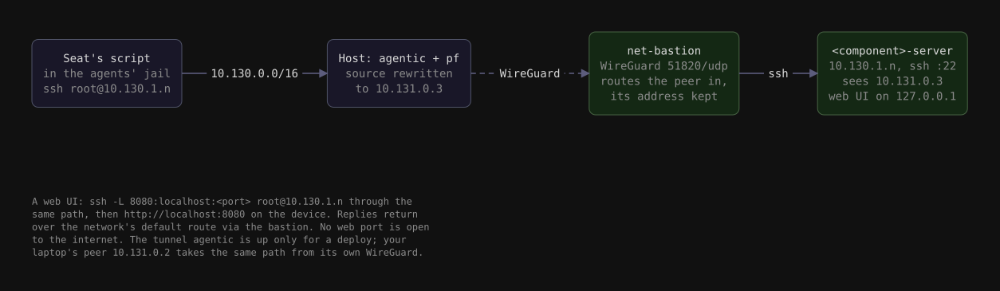
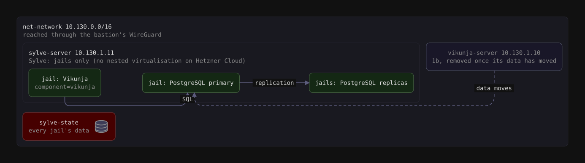

# Architecture

How production's components fit together, and why the platform has this shape. Each component's own what, why and how is in its README, under Infrastructure; the rules every component applies are in [CONSTANTS.md](../../imported/infra/CONSTANTS.md), section "Production". This page states them only to explain them.

## What

Production is one Hetzner Cloud project, `agentic-workflows`, in Falkenstein (`fsn1`). Its parts, each a **component** that owns its cloud resources whichever agent builds it:

| Component | Phase | State | What it is |
|---|---|---|---|
| `net` | 1a | built, 15 Nov 2026 | the private network 10.130.0.0/16, the bastion (its only way in and out), the firewall, the zone `dkl.cat` |
| `vikunja` | 1b | intent | one server on the private network running Vikunja and PostgreSQL |
| `sylve` | 1c | intent | one server on the private network running Sylve, which manages jails |
| `playbook` | | this site | the documentation, served locally |

Built parts are green, intended ones plain; dashed lines run inside WireGuard.

## Why this shape

- **One way in, one way out.** Servers on the private network have no public address. The bastion is the network's gateway to the internet (NAT out) and, through WireGuard, the only way in; the firewall in front of it lets in ssh, WireGuard and ICMP only. Few doors, each watched: the user's plan for Phase 1a (14 Nov 2026).
- **No web port on the internet.** Every web UI, Vikunja's and Sylve's, listens on the server's loopback and is reached through an ssh tunnel ([CONSTANTS.md](../../imported/infra/CONSTANTS.md) "Exposure").
- **Deploys go through WireGuard too.** Agents deploy from their own peer, not by ssh forwarded through the bastion, so the bastion holds no component's key (PA-Q23, PA-Q41).
- **Servers are disposable; state lives on cloud disks.** Each server's state is on its own cloud disk: rebuilding the server keeps it, and wiping it is a decision of its own (the user, 15 Nov 2026 00:55).
- **Protected from deletion.** Every resource that Hetzner can protect is protected; production has no script that deletes, and replacing a server is the user's step (PN-Q3).
- **Owned by components, not by agents.** A resource carries `component=<component>` and a name starting `<component>-`, so it stays maintainable after the agent that built it is gone (PA-Q12).
- **Fixed addresses and names.** Each server has a fixed address and a name under `private.dkl.cat`, from one table in [CONSTANTS.md](../../imported/infra/CONSTANTS.md) (PA-Q20).

## How a deploy reaches a server

The agents' jail shares the host's network but cannot send from a tunnel address, so the host's pf rewrites its traffic to the agents' peer, 10.131.0.3; the bastion forwards a peer's traffic into the network from its own private address. The user brings the agents' tunnel up for a deploy and down after. The steps: [Deploying a component](../processes/deploy-a-component.md).

## Intent: what comes next

Written ahead as a plan (PA-Q33); each part is kept current as it is built, and the component's README replaces it once built.

- **1b, `vikunja`**: Vikunja (pkg `latest`) and PostgreSQL on one server, 10.130.1.10, `vikunja.private.dkl.cat`; Vikunja on 127.0.0.1:3456 through an ssh tunnel; registration closed, no mail, no OIDC; its data on encrypted datasets of an unencrypted pool on `vikunja-state` (PV-Q1 to PV-Q5).
- **1c, `sylve`**: Sylve on one server, 10.130.1.11, `sylve.private.dkl.cat`, its state on `sylve-state`. Jails only: Hetzner Cloud offers no nested virtualisation, so Sylve runs no VMs there (tested 15 Nov 2026). Its details are being settled in prod-sylve's grilling.
- **Phase 2**: Vikunja, and PostgreSQL as a primary with replicas, move into jails on the Sylve server; the 1b server goes once its data has moved.

- **Phase 3**: registration, mail, OIDC, TLS and a proxy. **Phase 4**: an admin dashboard (PV-Q1).

## What stays the user's

Some resources carry no component label and no component changes them: the `role=admin` SSH keys, the server image, and the records the zone held before it came into the project ([CONSTANTS.md](../../imported/infra/CONSTANTS.md), PA-Q31). The read-write token exists only for a deploy; the user deletes it after.
