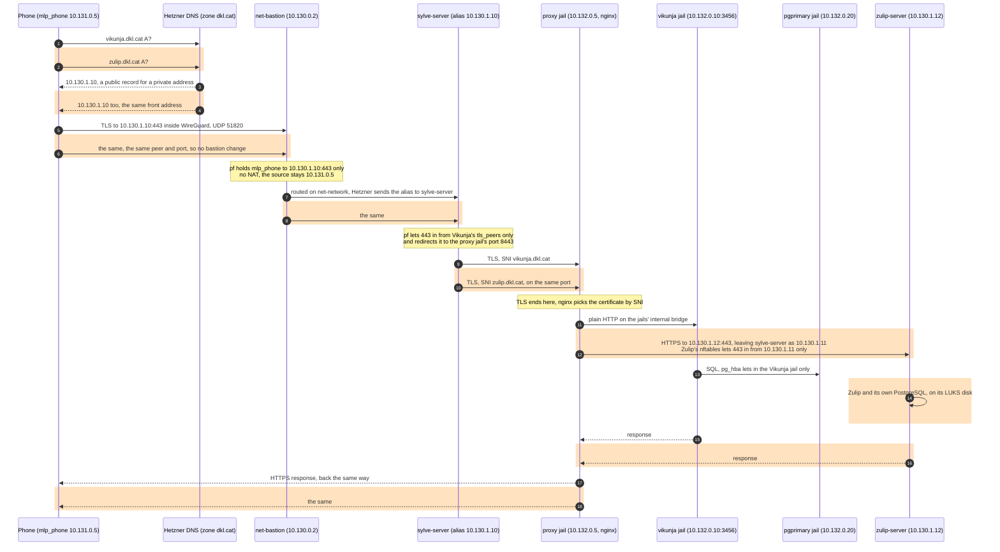
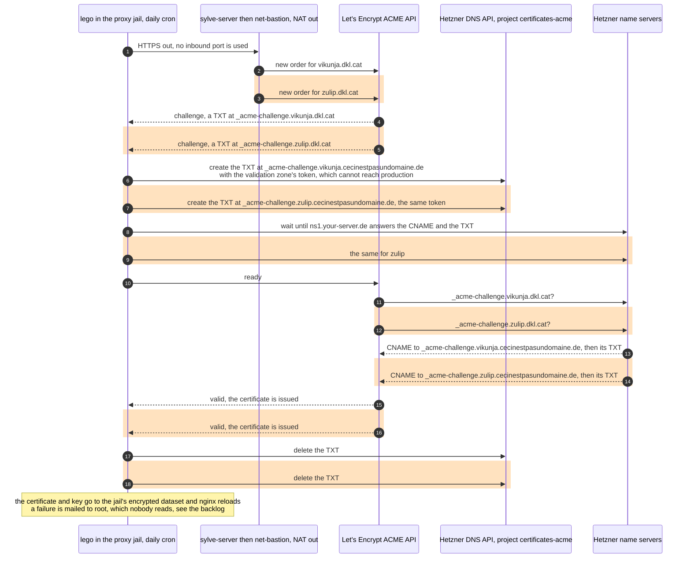

# Request journeys

How an incoming request travels through the network, and how a certificate is renewed. Plain arrows are `vikunja.dkl.cat`, as it runs today. Each orange band, just below an arrow, is the same step for `zulip.dkl.cat`, as decided but not yet built (PA-Q122; Vikunja tasks 194 and 195).

## A user's request

Everything is on the private network. The only door from the internet is WireGuard on the bastion. A peer's own address is kept as far as `sylve-server`, so each layer filters by who it really is ([SECURITY.md](../../imported/infra/SECURITY.md), "Exposure", and [CONSTANTS.md](../../imported/infra/CONSTANTS.md), "Deploys into the private network").

Sylve's UI follows the Vikunja journey to 10.130.1.11:443, from Sylve's peers, to the proxy's port 443. The agents reach both names the same way, from `vikunja-agents` (10.131.0.4).

## A certificate renewal (DNS-01)

Nothing comes into the network. Every connection goes outward through the NATs, and Let's Encrypt checks only public DNS at Hetzner. Port 80 is closed ([SECURITY.md](../../imported/infra/SECURITY.md), "Exposure", and [CONSTANTS.md](../../imported/infra/CONSTANTS.md), "Certificates").

The CNAME in `dkl.cat` is the delegation. A stolen validation-zone token can obtain certificates for the delegated names, but it touches no production resource.
